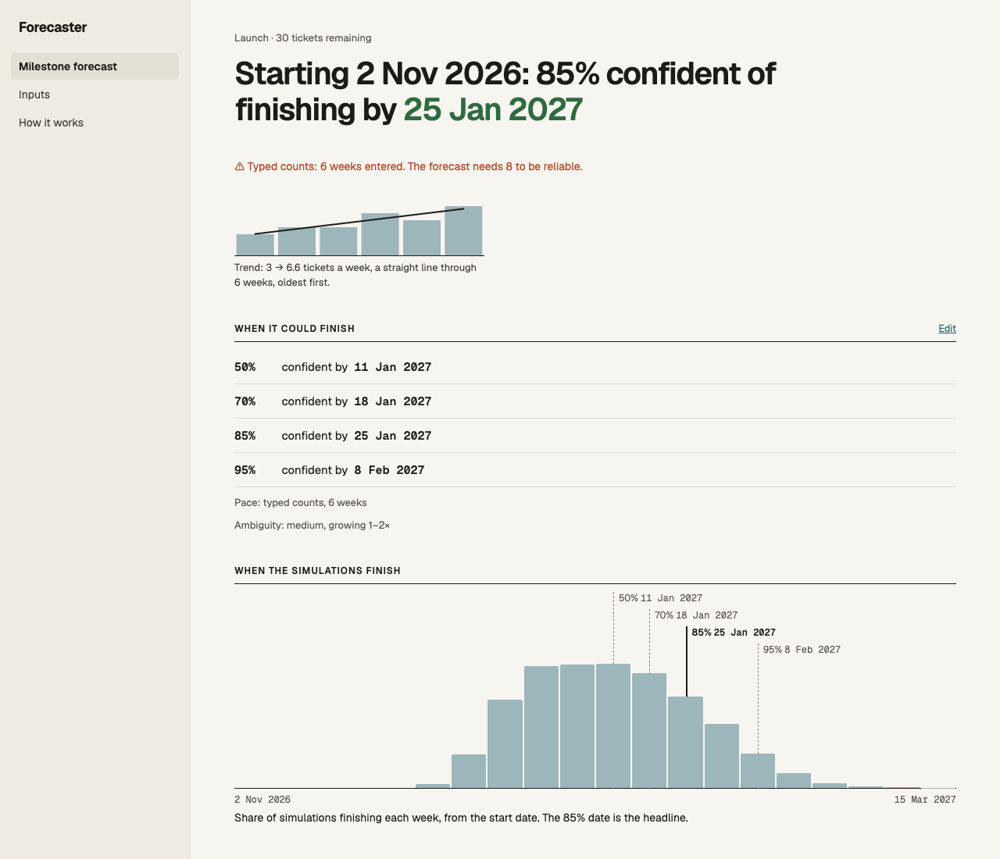
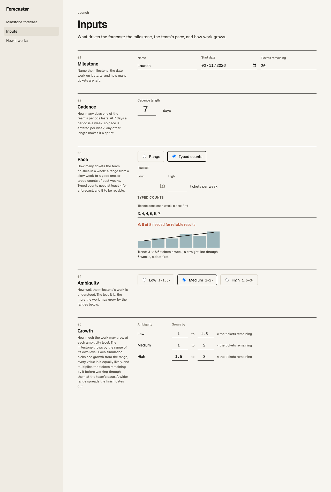

# PRD: Project Forecaster v1

5 Nov 2026 · Ralph Hockley

This is a copy of the [PRD as a Claude Doc](https://claude.ai/artifact/9oT8Z1jUP5mGQa6v2KAkvn). The diagrams and the chart are only in the Doc; each is linked below where it appears.

## Intro

Project Forecaster v1 lets an engineering manager (EM) say when a milestone will be done, as a confidence level and a date: "Starting 2 Nov 2026: 85% confident of finishing by 25 Jan 2027".

The EM types a handful of facts they already know. The Forecaster runs 10,000 simulated futures (Monte Carlo) and reports the 50%, 70%, 85% and 95% finish dates. It needs no ticketing tool, no connector and no committed date. It runs on the EM's own machine, or as one HTML file opened in a browser.

> **Diagram, in the [Doc](https://claude.ai/artifact/9oT8Z1jUP5mGQa6v2KAkvn):** how a forecast is made: what the EM types, grow the work, burn down at pace, read the dates. Repeated 10,000 times, one trial each.

Growth and pace are both drawn at random in each trial, so the spread of finish dates shows how much is still unknown.

**What the EM sees.** The Milestone forecast screen leads with the headline date and the four confidence dates. Below them are the pace trend and a graph of when the simulations finish. The Inputs screen holds everything the forecast uses, with each warning beside its input.

## Background and problem

EMs are asked "when will it be done?" and usually answer with one date from the average pace. That date is roughly a coin flip: half the time the work runs later. It also ignores how much a milestone grows once work starts.

The EM also wants to try options, chiefly "when are we done if we start on X?". The Forecaster before v1 couldn't answer that:

- its forecast always started on today's date;
- it needed epics, commits and ticket data from sample data or a connector before it forecast anything;
- it compared the result with a committed date the EM may not have.

Forecasts from short history were also too confident. With 10 weeks of history, even a perfectly steady team's actual finish fell outside the forecast's P10–P90 range 28% of the time, where a perfect forecast misses about 12% ([research](https://github.com/random11235/forecaster-next-gen/blob/main/docs/research/pace-stability/README.md#short-history-makes-every-range-too-narrow)).

> **Chart, in the [Doc](https://claude.ai/artifact/9oT8Z1jUP5mGQa6v2KAkvn):** v1 cuts missed ranges for every team type. Share of forecasts whose P10–P90 range missed, from 10 weeks of history, plain bootstrap → Bayesian bootstrap: one odd week 24% → 17%, steady 27% → 18%, lumpy 38% → 25%, team change 54% → 44%, good and bad spells 55% → 45%, speeding up 77% → 67%. A perfect forecast misses 12%. Source: [pace-stability research](../research/pace-stability/README.md), 400 synthetic histories per team type.

The Bayesian bootstrap closes more than half the gap for steady teams and makes no team type worse. Teams whose pace is changing still miss often, which is why v1 adds the pace trend.

## Goal

Give an EM an honest finish range for one milestone, from what they know today, in a couple of minutes, with nothing to install or connect.

**Goals**

- Forecast from a start date the EM chooses, past or future.
- Need only typed inputs: no ticketing tool, connector or sample data.
- Make the ranges right: P10–P90 misses about 1 time in 5, even from short history.
- Give the same forecast for the same inputs every time, so any shared number can be explained.
- Let testers try it from one file, with their data kept on their own machine.

**Non-goals for v1**

- Epics, commits, pull-backs, blocked epics and per-epic ambiguity.
- Connectors (Jira, GitHub), measured pace and measured growth.
- A committed date, or any comparison against one.
- Scenarios, risks, capacity and absences, "how many by date", and a burn-down graph.
- More than one team, or hosting.

## Users

v1 is for an EM of a single team who has to give stakeholders a finish date for a milestone.

- **Before work starts:** "If we start on 1 Sep, when are we 85% sure of finishing?"
- **During the work:** update the tickets remaining and the latest sprint's count, and re-forecast.
- **Looking back:** set a past start date to ask when the team would have finished had it started then.
- **With no history:** forecast from a low–high pace range, such as 4–8 tickets a week.
- **Explaining it:** read out which pace the forecast used, and see the spread of finish dates as a graph.

## Requirements

v1 is the MVP ([#84](https://github.com/random11235/forecaster-next-gen/issues/84)) plus three additions: the pace trend ([#120](https://github.com/random11235/forecaster-next-gen/issues/120)), the calibration test ([#121](https://github.com/random11235/forecaster-next-gen/issues/121)) and the browser build ([#57](https://github.com/random11235/forecaster-next-gen/issues/57)). The spec lists 42 user stories; these are the main ones.

> **Roadmap, in the [Doc](https://claude.ai/artifact/9oT8Z1jUP5mGQa6v2KAkvn):** MVP (#84, built) → v1 additions (#120, #121, #57; in review in PR #123) → after v1 (#6 epics and commits, #133 connected forecasting). v1 is done when PR #123 merges.

| Area | Requirement | Ticket |
| --- | --- | --- |
| Inputs | The EM enters a name, a start date (pre-filled with today), tickets remaining, one ambiguity level, the cadence in days (default 7) and pace. | #84 |
| Inputs | Pace is a low–high range per period, or typed counts of tickets done in past periods; both are kept, and the EM picks which one the forecast uses. | #84 |
| Inputs | Ambiguity is low, medium (default) or high, growing the tickets by 1–1.5×, 1–2× or 1.5–3×. The EM can edit these ranges. Growth never takes the total below today's tickets remaining. | #84 |
| Inputs | An input that can't be forecast is refused, says why, and keeps what was typed. Each warning sits beside the input it names. | #84 |
| Inputs | Typed counts need at least 4 for a forecast, and warn until there are 8. | #84, #119 |
| Forecast | The headline reads "Starting 2 Nov 2026: 85% confident of finishing by 25 Jan 2027", with the 50%, 70% and 95% dates below it. | #84 |
| Forecast | A graph shows when the trials finish, by week or sprint, with the four dates marked. | #84 |
| Forecast | Dates beyond the 156-period horizon show as "later than \<date>"; dates before today are marked "already past". | #84 |
| Forecast | The same inputs always give the same forecast. | #84 |
| Pace trend | With 4 or more typed counts, both screens show them as bars with a best-fit line. It is for information only; the forecast is unchanged. | #120 |
| Engine | Typed counts are drawn by the Bayesian bootstrap, so ranges from short history widen to match what is really known ([ADR-0001](https://github.com/random11235/forecaster-next-gen/blob/main/docs/adr/0001-bayesian-bootstrap-pace-sampler.md)). | #121 |
| Builds | A local server started with one command keeps inputs in a local SQLite file. | #84 |
| Builds | A browser build is one HTML file (about 210 KB), shared by email, chat or a shared drive. It loads nothing from outside and keeps each tester's inputs in their own browser. | #57 |

## Success metrics

v1 meets all three of its quality bars, each checked by a test on every change. Measures of whether testers find it useful are not set yet (see Open questions).

| Measure | Target | v1 result |
| --- | --- | --- |
| Ranges are right: steady teams' actual finish falls outside P10–P90 | About 1 time in 5 (test band 12–24%) | 17.6% (the plain bootstrap gave 27.7%) |
| Speed: 10,000 trials over a realistic milestone | Within 100 ms | About 11 ms on a laptop |
| Privacy: anything loaded from outside the file or server | Nothing, fonts included | Nothing; [private-data review on #57](https://github.com/random11235/forecaster-next-gen/issues/57#issuecomment-6552633943) |

The calibration figures use synthetic steady teams. Once real milestones finish, a track record of past forecasts against actual finishes is meant to take over this check.

## Risks and open questions

**Risks**

| Risk | Effect | Mitigation |
| --- | --- | --- |
| A team's pace is changing (speeding up, or a team change) | The forecast is too confident; the Bayesian bootstrap doesn't fix this | The pace trend shows the change; investigated in [#42](https://github.com/random11235/forecaster-next-gen/issues/42) |
| Calibration rests on synthetic teams only | Real teams may miss more often than 1 in 5 | A track record of real forecasts, after v1 |
| Testers forward the file to people it wasn't meant for | Low: the file holds no data; each tester's inputs stay in their own browser | Private-data review on #57 |
| A browser that blocks site data, such as a private window | Inputs are lost when the page closes | Stated in the README |

**Open questions**

- [ ] A past start date with today's tickets remaining can give finish dates already past. Is marking them "already past" enough?
- [ ] How will we judge whether testers find v1 useful, and who are the first testers?

## Glossary and references

| Term | Meaning |
| --- | --- |
| Ambiguity | How well the milestone's work is understood: low, medium or high, each a range the tickets may grow by |
| Cadence | The length of one of the team's periods in days: a "week" at 7, a "sprint" otherwise |
| Typed counts | Tickets the team finished in each past period, oldest first, as the EM types them |
| Pace trend | The typed counts drawn as bars with a best-fit line, for the EM to read; the forecast doesn't use it |
| Trial | One simulated future; a forecast runs 10,000 and reads its dates from when they finish |
| Bayesian bootstrap | Drawing pace from typed counts with fresh random weights in each trial, so short history gives a wider range |

**After v1:** epics, commits and connected forecasting, where typed counts are proposed from comparable work in Jira or GitHub ([#6](https://github.com/random11235/forecaster-next-gen/issues/6), [#133](https://github.com/random11235/forecaster-next-gen/issues/133)).

**Sources**

- [MVP spec, #84](https://github.com/random11235/forecaster-next-gen/issues/84)
- [ADR-0001: Bayesian bootstrap is the default pace sampler](https://github.com/random11235/forecaster-next-gen/blob/main/docs/adr/0001-bayesian-bootstrap-pace-sampler.md)
- [Pace stability research](https://github.com/random11235/forecaster-next-gen/blob/main/docs/research/pace-stability/README.md)
- [Design docs](https://github.com/random11235/forecaster-next-gen/blob/main/docs/design/README.md)
- [v1 pull request, #123](https://github.com/random11235/forecaster-next-gen/pull/123)
